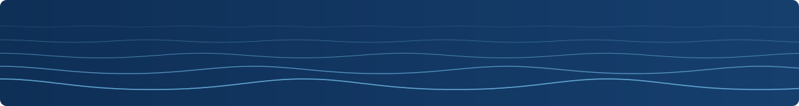
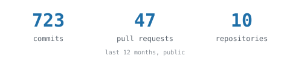

<!-- img/header-band.svg and img/footer-band.svg are drawn by scripts/header.py.
     The languages line and img/stats-*.svg are rewritten weekly by scripts/profile.py. -->

  

  
   
  <samp>data engineering · computational physics</samp>

<!-- languages:start -->
  <samp>Python · TypeScript · SQL · JavaScript · Rust · Go</samp>
  <!-- languages:end -->

 

  <picture>
    <source media="(prefers-color-scheme: dark)" srcset="img/stats-dark.svg" />
    
  </picture>

  

